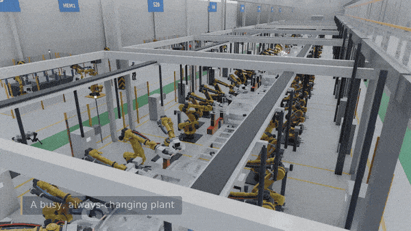
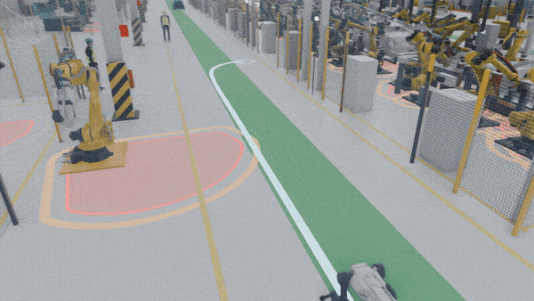
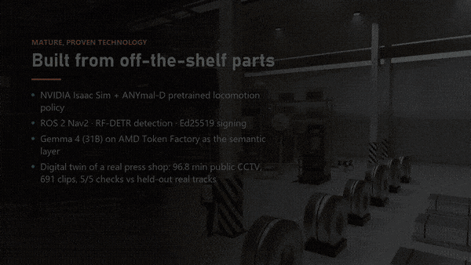
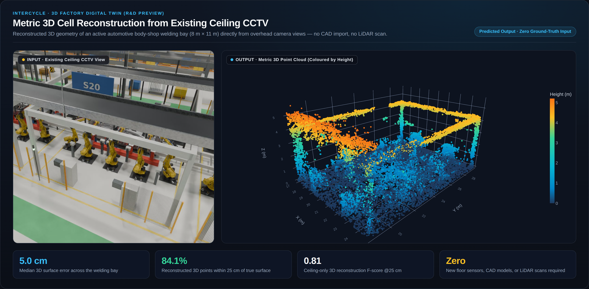
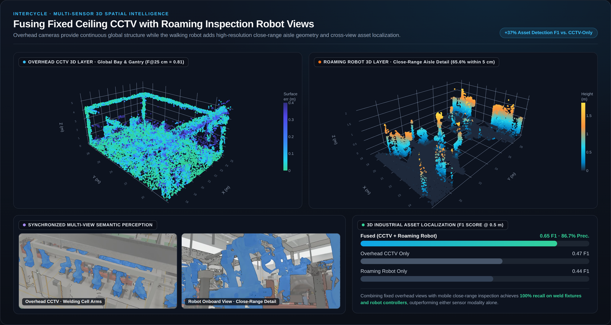
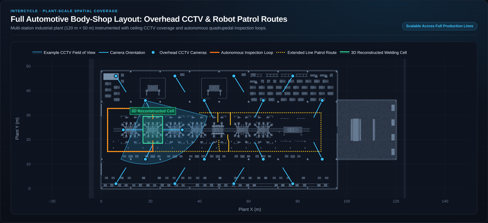

<div align="center">

# InterCycle

**The cameras a factory already has, guiding the robots it is deploying.**

[](LICENSE)
[](#how-it-works)
[](#system-in-action)
[](https://lablab.build/ai-hackathons/amd-developer-hackathon-act-iii/workflux/intercycle)

[System in Action](#system-in-action) · [Benchmark Results](#results) · [3D Digital Twin R&D](#next-multi-view-3d-factory-digital-twin-active-rd) · [How It Works](#how-it-works) · [Reproduce](#reproduce)

</div>

---

Industrial inspection robots today are largely confined to planned shutdowns—entering an active automotive line risks protective stops that can cost up to ~$2.3M/hr in downtime (Siemens, 2024).

**InterCycle** adds a software-only observer layer on top of a plant's existing ceiling CCTV. It learns when and where each machine, worker, and forklift moves, and broadcasts a cryptographically signed dynamic map to an inspection robot's standard **ROS 2 Nav2** stack—enabling autonomous inspections **between machine cycles** with **no new floor sensors and no PLC integration**. InterCycle is an advisory planning layer, not a safety function; the plant's light curtains and the robot's certified safety scanner remain the safety layer.

<table>
  <tr>
    <td align="center" width="50%">
      
      <br />
      <sub><b>1. Existing CCTV → Observer Layer:</b> Watches existing ceiling cameras and learns dynamic machine hazard envelopes and traffic corridors across the active body shop.</sub>
    </td>
    <td align="center" width="50%">
      
      <br />
      <sub><b>2. Live Robot Behaviour:</b> Replans smoothly around active robot-arm hazard zones and oncoming workers without stopping, then inspects the welding bay during a predicted idle window.</sub>
    </td>
  </tr>
</table>

| **5.2x** | **0 trips · 380x less downtime** | **85% of PLC oracle** | **23 / 23 (1.00 precision)** |
| :---: | :---: | :---: | :---: |
| Inspections / production hour vs. shutdown-only (`39.9` vs. `7.6`) | Zero safety trips and `1.5 s` line time lost vs. `5.0` trips & `568 s` reactive | Throughput of a future-knowing PLC oracle, from video alone | Real factory press strokes detected in a sealed blind CCTV test |

---

## System in Action

### Physics-Verified Locomotion in NVIDIA Isaac Sim

End-to-end navigation and inspection missions are validated with a pretrained **ANYmal-D** quadrupedal locomotion policy running standard **ROS 2 Nav2** under full rigid-body physics inside **NVIDIA Isaac Sim** (`2 of 2` navigation legs completed, `0` contacts, under `4.4¢` of cloud GPU compute per mission).

<p align="center">
  
  <br />
  <sub><b>Physics verification (NVIDIA Isaac Sim):</b> Pretrained ANYmal-D executing its inspection patrol with zero contacts.</sub>
</p>

---

## Results

### Automotive Body Shop Simulation

20 seeds × 6 hours per strategy (event simulation, commit `1671f9e`):

| Robot strategy | Inspections / production hour | Safety trips / run | Line time lost / run |
| :--- | :---: | :---: | :---: |
| **InterCycle** | **39.9** | **0** | **1.5 s** |
| Reacts to its own camera | 50.4 | 5.0 | 568 s |
| Inspects only during shutdowns | 7.6 | 0.25 | 23 s |
| PLC oracle *(knows the future, upper bound)* | 46.7 | 0 | 0 s |

- **5.2x the inspections** of a shutdown-only robot.
- **Zero safety trips** and **380x less line time lost** than a robot reacting only to its own camera.
- **85%** of the throughput of a PLC-wired oracle that knows every machine's future—from ceiling video alone.

On the current harsher simulation where the robot's own onboard camera can miss, misread, or lag, InterCycle retains **3.3x fewer safety trips** (`3.35` vs. `10.95`) and **3.7x less line time lost** (`305 s` vs. `1,135 s`) than the reactive baseline at **88.6%** of oracle throughput (remaining edge cases tracked as `E-W6` in [`docs/WEAKNESSES.md`](docs/WEAKNESSES.md)).

### Real Factory CCTV (Sealed Blind Test)

Evaluated once on **126 held-out real industrial CCTV clips** with pass thresholds pre-committed in advance (`prereg/`, `sealed/`):

- **23 of 23** detected press strokes were real (**1.00 precision**).
- **82 of 83** detected people placed in the correct floor zone (**98.8% zone accuracy**).

---

## Next: Multi-View 3D Factory Digital Twin *(Active R&D)*

While InterCycle today builds a live 2D dynamic observer on top of a one-time site-plan import, our ongoing R&D extends the same **existing-cameras-first** philosophy into full **metric 3D factory reconstruction and semantic asset mapping**—combining fixed overhead CCTV with roaming inspection robot cameras so plants can bootstrap a living 3D digital twin with **zero CAD imports and zero LiDAR scans**.

<p align="center">
  
  <br />
  <sub><b>Metric 3D reconstruction from ceiling CCTV alone (predicted output, zero ground-truth input):</b> Full welding-bay structure, overhead gantry, safety fencing, and equipment reconstructed at <b>5.0 cm median surface error</b>, <b>84.1%</b> of points within 25 cm, and <b>F@25 cm = 0.81</b>.</sub>
</p>

<p align="center">
  
  <br />
  <sub><b>Multi-view fusion (overhead CCTV + roaming robot):</b> Fixed overhead views provide continuous global cell geometry while close-range robot patrols add fine aisle detail (<b>65.6%</b> of close-range points within 5 cm). Fusing both modalities lifts <b>3D industrial asset localization to 0.65 F1 (86.7% precision)</b>—a <b>+37%</b> gain over CCTV-only (<code>0.47</code>) and <b>+46%</b> over robot-only (<code>0.44</code>), with <b>100% recall</b> on weld fixtures and robot controllers.</sub>
</p>

<p align="center">
  
  <br />
  <sub><b>Plant-scale spatial coverage:</b> Multi-station automotive body shop (120 m × 50 m) combining overhead ceiling CCTV coverage with autonomous quadrupedal inspection loops across the production line.</sub>
</p>

---

## How It Works

**`Watch` → `Learn` → `Broadcast` → `Inspect`**

1. **Watch** ([`intercycle/perception/`](intercycle/perception/)): Ingests existing ceiling CCTV feeds. Every detected person is masked before any image leaves the perception boundary.
2. **Learn** ([`intercycle/observer/`](intercycle/observer/)): Learns each machine's cycle and sub-phases, tracks running/stopped/andon plant states, and models pedestrian and forklift traffic flows by time of day.
3. **Broadcast** ([`intercycle/codec/`](intercycle/codec/)): Packs a layered dynamic map signed with **Ed25519** into payloads compact enough for redundant Wi-Fi / Bluetooth LE delivery. Forged, tampered, expired, and replayed messages are rejected.
4. **Inspect** ([`ros2/intercycle_nav/`](ros2/intercycle_nav/)): Feeds directly into standard ROS 2 Nav2 `KeepoutFilter` and `SpeedFilter`, timing each cell entry to high-confidence predicted idle windows.

### Fail-Closed Safety Principles

- **Unknown = occupied:** Never-observed or stale floor space always defaults to keep-out.
- **Monotonic restriction:** Broadcast maps can only *add* keep-out zones and *lower* speed limits—never override or open a closed area.
- **Camera watchdog:** A frozen, occluded, or offline camera automatically flips its floor region to `UNKNOWN`.
- **Cryptographic trust chain:** Robots without a valid trusted signing key ignore all broadcasts.
- **Privacy by design:** Workers are masked at ingest; only aggregate flow statistics leave the perception stage.

Further technical details: [`docs/MAP.md`](docs/MAP.md), [`docs/STATUS.md`](docs/STATUS.md).

---

## Reproduce

### Install

Requires Python 3.11+ and Git. All core tests and event simulations run on CPU.

```bash
git clone https://github.com/Alexanderis1/intercycle.git
cd intercycle
python -m venv .venv
source .venv/bin/activate            # Windows (Git Bash): source .venv/Scripts/activate
pip install -e ".[dev]"
export PYTHONUTF8=1
export PYTHONPATH="$PWD:$PWD/ros2/intercycle_nav:$PWD/ros2/intercycle_eval"
# Windows: export PYTHONPATH=".;ros2/intercycle_nav;ros2/intercycle_eval"
```

### Quickstart (~1 minute)

```bash
# Signed broadcast, trust chain, camera watchdog, observer/simulator wall: 110 tests, ~10 s
python -m pytest -q tests/test_codec.py tests/test_ble.py tests/test_trust.py tests/test_watchdog.py tests/test_no_truth_import.py

# Body-shop simulation, smoke version (2 seeds x 1 h), writes out/bodyshop_quick/
python -m intercycle.eval.bodyshop --quick
```

### One Command per Result

| Result | Command | Output |
| :--- | :--- | :--- |
| Body-shop table above (commit `1671f9e`) | `git switch --detach 1671f9e && python -m intercycle.eval.run_seeds --seeds 0 19` | Table on screen and `out/results_dev_0_19.json`; committed copy: [`results/bodyshop/eventsim_1671f9e/`](results/bodyshop/eventsim_1671f9e/) |
| Body shop, current harsher sim (noisy robot camera) | `python -m intercycle.eval.bodyshop --seeds 0-19 --hours 6` | [`results/bodyshop/RESULTS.md`](results/bodyshop/RESULTS.md), `summary.json` |
| Sealed real-clip test | Already run once, by design; scores committed | [`results/sealed/realclip_test_attempt_001.json`](results/sealed/realclip_test_attempt_001.json), [`RUNLOG.json`](results/sealed/RUNLOG.json) |
| Real-clip development set | Committed scores | [`results/dev/realclip_dev.json`](results/dev/realclip_dev.json) |
| Legged ANYmal-D on Nav2 in NVIDIA Isaac Sim (2/2 legs, 0 contacts, < 4.4¢ compute) | Committed verdict (run on Modal GPU, [`cloud/modal_isaac_robot.py`](cloud/modal_isaac_robot.py)) | [`docs/probes/S5a_isaac_smoke_verdict.json`](docs/probes/S5a_isaac_smoke_verdict.json) |
| Full test suite | `python -m pytest -q` | Several minutes |

> The sealed real-clip test cannot be re-run directly from this repository: held-out clips stay outside the repo, and only their SHA-256 hashes and preregistered pass criteria are committed (`sealed/`, `prereg/`).

---

## Limits

- Body-shop throughput and downtime results come from simulation, not yet a live production plant.
- Real-clip evaluation labels are AI-agent labels rather than human-annotated ground truth.
- 3D digital twin R&D results shown above come from simulated multi-camera automotive body-shop environments (development cell).
- Not yet demonstrated: physical robot deployment under live plant cameras, or formal industrial safety certification.

---

## Credits & Licences

- **Code:** MIT ([`LICENSE`](LICENSE)).
- **Real CCTV clips:** Önal, O. and Dandıl, E. (2024), *Data in Brief* 56, 110791, via Hugging Face `Voxel51/Safe_and_Unsafe_Behaviours` (CC BY 4.0). Trimmed, re-encoded, people masked. No affiliation or endorsement.
- **3D & Robotics Assets:** ANYmal-D model (BSD-3-Clause, ANYbotics); NVIDIA SimReady assets (CC-BY-4.0); Gemma 4 (Apache-2.0, served via AMD Token Factory).
- **Demo Submission:** [AMD Developer Hackathon ACT III — InterCycle on LabLab](https://lablab.build/ai-hackathons/amd-developer-hackathon-act-iii/workflux/intercycle).

**Author:** Alessandro Angelo Anzellini. Special thanks to Ing. Emanuele Musumeci.
